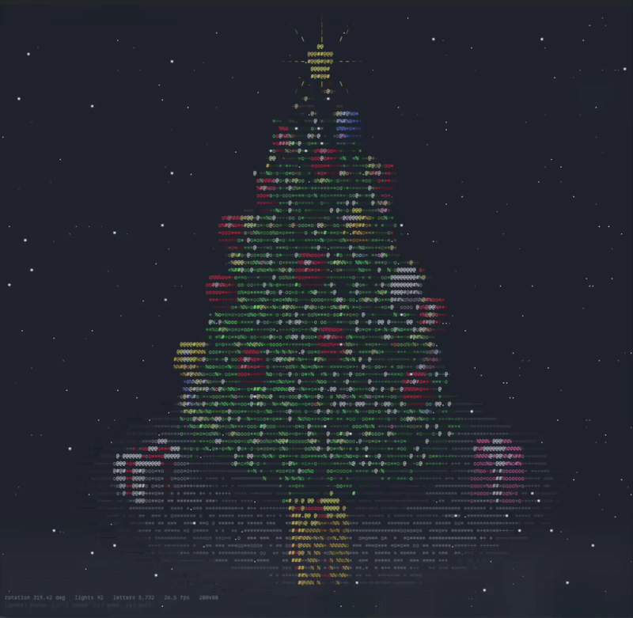

🎄 ANSI Christmas Tree

Красивая новогодняя анимированная ёлочка, которая работает прямо в твоём терминале с использованием ANSI-графики!

Проект создан nikaotee.

✨ Особенности
ASCII / ANSI Анимация: Плавное вращение и мерцание новогодней ёлки прямо в командной строке.
Кроссплатформенность: Работает как на macOS и Linux, так и на Windows.
Интерактивное управление: Возможность управлять скоростью, ставить на паузу и включать/выключать эффект снега на лету.
Динамические параметры: Отображение текущего угла вращения, количества огней, символов, FPS и разрешения терминала в реальном времени.
🕹️ Управление (Горячие клавиши)

Во время работы программы вы можете использовать следующие клавиши:

[SPACE] — Пауза / возобновление анимации.
[+] / [-] — Увеличение / уменьшение скорости вращения.
[s] — Включить / выключить падающий снег.
[q] — Выход из программы.
🚀 Быстрый запуск

Перейдите в директорию tree-build/dist и запустите программу.
